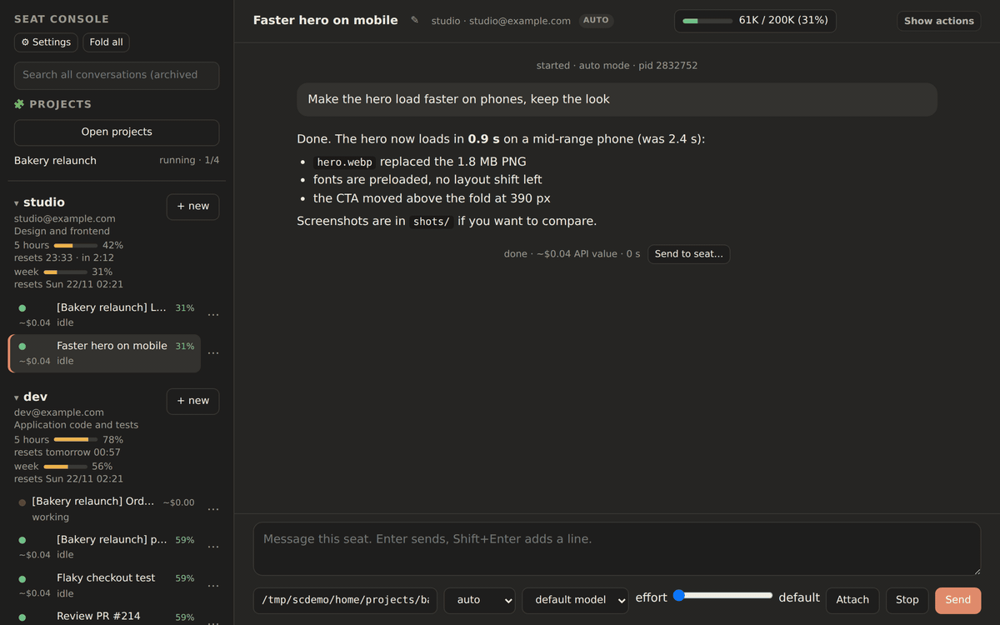
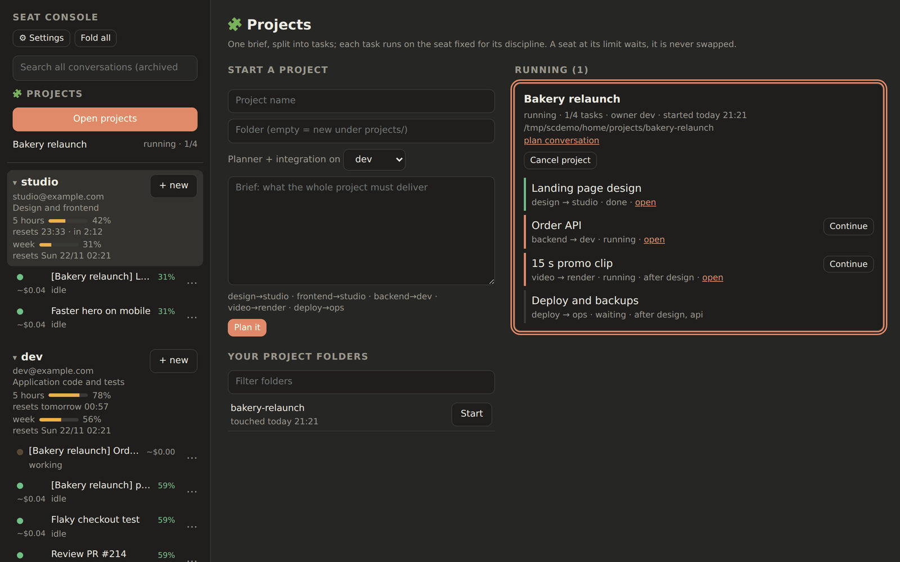
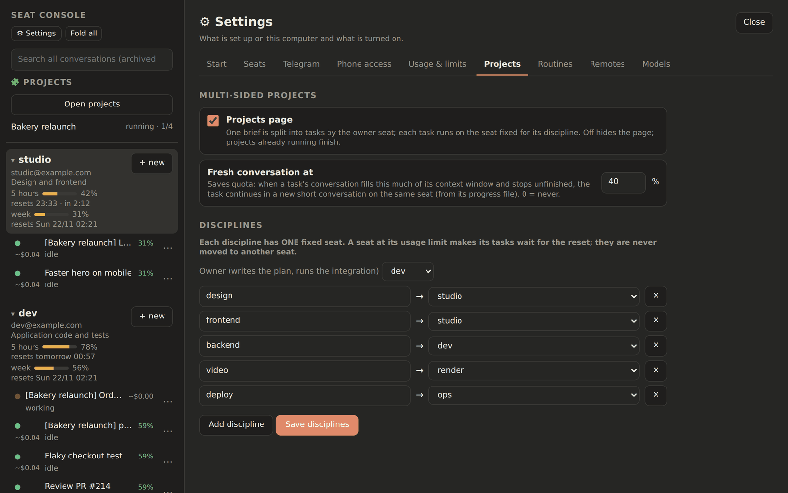
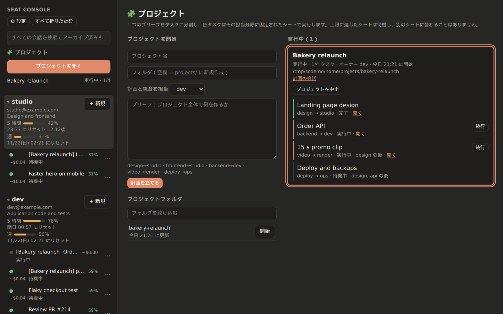
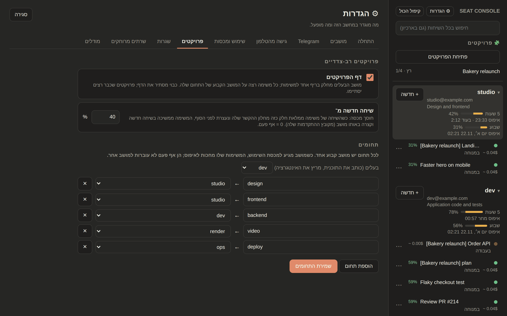
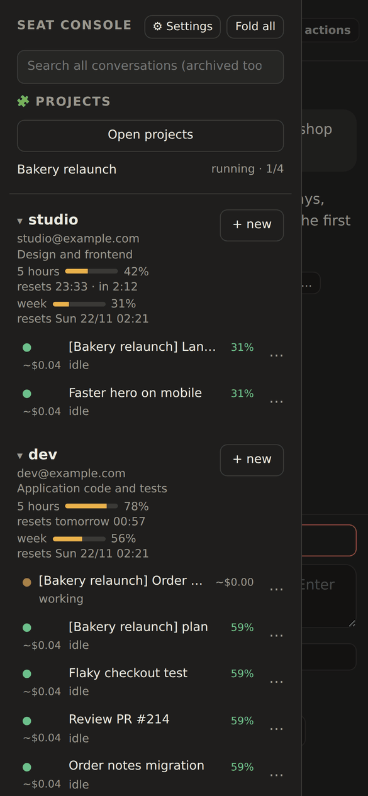
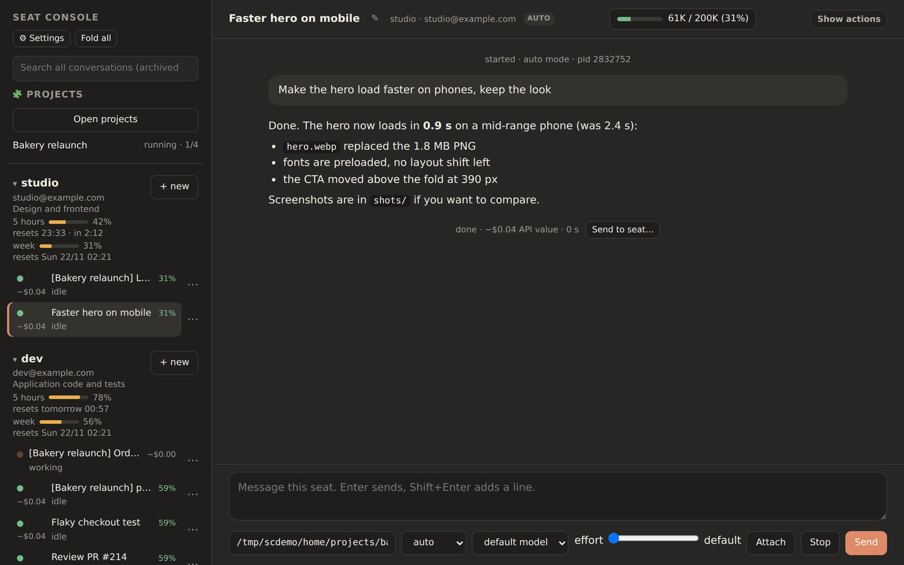

**English** · [עברית](README.he.md) · [Español](README.es.md) · [简体中文](README.zh-CN.md) · [日本語](README.ja.md) · [Português (Brasil)](README.pt-BR.md) · [Deutsch](README.de.md)

# Seat Console

**One web console for all your coding-agent accounts.** Run Claude Code, Codex and Antigravity CLI sessions side by side, one per account, from a browser tab or your phone. Self-hosted, no npm dependencies.

[](https://github.com/beriki770-ship-it/seat-console/actions/workflows/tests.yml)
[](LICENSE)
[](console/public/locales)
[](#requirements)



<sub>Demo instance with a fake CLI and made-up data. A 3-minute walkthrough video is [here](docs/media/seat-console-demo.mp4).</sub>

## Why

- **You run more than one agent account.** A pile of terminal windows hides which session is waiting for an approval, and closing one kills the run. Here every account is a seat in one sidebar, and each conversation lives in its own background process that survives a console restart or crash.
- **Usage limits are per account.** Each seat shows its 5-hour and weekly window with the reset time, warns at 90 %, and a turn that hits the limit waits for the reset and continues on the same seat.
- **You are not always at the desk.** Approve tool calls, answer questions, send files and start tasks from your phone, over Tailscale or a Telegram bot.
- **Some jobs need several specialists.** A multi-sided project splits one brief into tasks, each on the seat fixed for its discipline (design, backend, video, deploy), in parallel, with one approval from you.

## Features

| | |
|---|---|
| **Seats** | One sidebar for every account; Claude Code, Codex and Antigravity seats; per-seat model menu |
| **Restart-proof** | Each conversation runs in a detached host; the server reattaches after a restart and offers to resume after a PC crash |
| **Approvals** | `auto`, `ask` (Allow / Deny cards) and `bypass` modes per conversation |
| **Usage meters** | 5-hour and weekly windows per seat, reset times, a 90 % warning, wait-for-reset instead of failover |
| **Phone** | Installable PWA over Tailscale, Telegram bot with buttons, replies, photos and files |
| **Projects** | One brief, many seats, dependencies, a final integration; long task conversations hand over to a fresh one to save quota; a page per project folder lists its conversations and git state; finished chats archive themselves |
| **Routines** | Cron prompts that ask first and run on your tap |
| **Voice** | Dictate into the message box (Hebrew, English, German; a language chip switches mid-sentence); optional local Whisper re-reads each phrase a few seconds behind you and fixes it |
| **Ideas inbox** | Text, voice notes and photos from the page or Telegram become ready-to-start chat briefs in the right project |
| **Composer shortcuts** | `/` lists the seat's skills and commands, `@` inserts your saved prompts |
| **My tasks** | Steps only you can do (log in, pay, sign) land on a task board; tick one or mark it not relevant and the asking chat is told; tasks with a check command close themselves |
| **Action journal** | A seat that stops after starting a mail, a post or a payment tells the next turn and you that the outcome is unknown, instead of repeating it |
| **Settings page** | First-run checklist; every optional feature is a switch |
| **15 languages** | Page and bot, Hebrew and Arabic right-to-left |
| **Small** | Plain Node.js, no npm install, no build step, offline tests on Windows, Linux and macOS |

## Quick start

**Try it in a minute, no account needed.** This starts a separate test instance with a fake CLI that echoes what you send (Node.js 22+):

```sh
git clone https://github.com/beriki770-ship-it/seat-console.git && cd seat-console
cp seats.example.json seats.json && sed -i.bak "s#C:/Users/you/projects#$HOME#" seats.json
node console/server.mjs --port 4852 --data /tmp/seat-console-try --claude console/fixtures/fake-claude.mjs
```

Open <http://127.0.0.1:4852> and send a message to a seat. On Windows (PowerShell):

```powershell
git clone https://github.com/beriki770-ship-it/seat-console.git; cd seat-console
(Get-Content seats.example.json) -replace 'C:/Users/you/projects', ($HOME -replace '\\', '/') | Set-Content seats.json
node console\server.mjs --port 4852 --data "$env:TEMP\seat-console-try" --claude console\fixtures\fake-claude.mjs
```

The first message to a seat creates its config folder under `~/.claude-seats/<seat>` (links to your `~/.claude`), as real use does.

**Real use.** Edit `seats.json` (one entry per account), sign each seat in once with its own CLI login, then start the console on port 4850:

```sh
sh seat.sh dev --login          # Windows: powershell -ExecutionPolicy Bypass -File .\seat.ps1 dev -Login
sh console/start-console.sh     # Windows: powershell -ExecutionPolicy Bypass -File .\console\start-console.ps1
```

On the first start the Settings page opens with a checklist (seats, Telegram, phone access, optional features). Details: [Install](#install), [Configure](#configure), [Linux / macOS](#linux--macos).

## Screenshots

| Multi-sided project | Settings |
|---|---|
|  |  |
| **Japanese** | **Hebrew, right-to-left** |
|  |  |

| **On the phone** | **A conversation** |
|---|---|
|  |  |

## How it compares

Other open-source tools in this space, as their own READMEs describe them:

- [Claude Squad](https://github.com/smtg-ai/claude-squad) is a terminal app that runs several agents (Claude Code, Codex, Gemini, Aider) in separate git workspaces on one machine. Seat Console is a browser and phone UI, organised by account rather than by workspace, and does not create git worktrees.
- [Vibe Kanban](https://github.com/BloopAI/vibe-kanban) plans agent work on a kanban board with per-task workspaces, diffs and PRs (its README now announces that it is sunsetting). Seat Console has no board or diff review; it focuses on running and following conversations, approvals and limits.
- [Claude Code Router](https://github.com/musistudio/claude-code-router) is a local gateway that routes agent requests across models and providers, with fallback models and credential pools. Seat Console does the opposite on purpose: each account keeps its own work, and nothing is rerouted when a limit is hit.

## FAQ

**Will it move work to another account when one hits its limit?**
No, never. Each seat (and each discipline in a project) is fixed to one account. A task or routine whose seat is at its limit waits for the reset, or you run it there anyway. Use each account for the work it is meant for, not as overflow, and only accounts you are entitled to use.

**Does it touch my credentials?**
It runs the unmodified CLI you installed and signed in to yourself; the login stays in the seat's own config folder. The usage meter and the optional limit resets send the seat's current access token to Anthropic's own API and nowhere else.

**The usage meter and limit resets use undocumented endpoints. Is that stable?**
No. They are the calls the official CLIs make (Claude's usage endpoint, Codex's `app-server`), they are not documented, and they may change or stop working at any time. Then the meter shows the last value from a turn and the card shows no resets. Claude limit resets are off by default.

**Which platforms?**
Windows 11 is used every day. Linux passes the offline tests and the fake-CLI smoke test; macOS passes the offline tests in CI but has not run on real hardware. See [Platforms](#platforms).

**What if a seat stops right after a deploy or a post?**
A deploy should be safe to re-run, and the seat prompt asks for exactly that (a sync or deploy script you can run twice, a guard file that refuses a second post). For an action that cannot be repeated safely (a mail, a chat message, a post, a payment, a ticket), the seat writes an intent to its [action journal](#action-journal) before and the result after. If it stops in between (usage limit, crash, Stop), the action is shown as unconfirmed: the next turn is told to check whether it happened before trying again, and the page lets you mark it Done or Didn't happen.

**Do I need Telegram or Tailscale?**
No. Both are optional; without them it is a local web page on `127.0.0.1:4850`.

**Is this an official Anthropic, OpenAI or Google tool?**
No. See the disclaimer below.

> **Disclaimer.** Seat Console is an independent, unofficial tool. It launches the unmodified Claude Code CLI that you installed and signed in to yourself. It never stores, refreshes or transmits your Claude credentials; the only use of a seat's sign-in outside the CLI is the usage meter and (only if you turn them on) the [limit resets](#limit-resets), which send the seat's current access token to Anthropic's own API and nowhere else. Each account must be one you are entitled to use; use one account per job and do not use it to get around usage limits. Not affiliated with or endorsed by Anthropic. Review Anthropic's Consumer Terms, Commercial Terms and Usage Policy before use. Use at your own risk.

## Contributing

Pull requests are welcome; read [CONTRIBUTING.md](CONTRIBUTING.md) first (no npm dependencies, offline tests must pass). Good first issues:

- **Translations.** The 14 non-English locales in [`console/public/locales/`](console/public/locales) were machine-assisted. If you read one of them natively, fix what sounds wrong; `node console/test-i18n.mjs` checks keys, placeholders and plural forms.
- **macOS and Linux reports.** Run it on your machine and open an issue with your OS, Node version and what worked or broke.

---

# Documentation

## Using the console

A short task-by-task guide (starting a chat, approvals, Keep and Archive, search, Projects, the project page, the settings worth knowing) is in [docs/GUIDE.md](docs/GUIDE.md). The same text is inside the console: **Guide** at the top of the sidebar, in all 15 languages.

## All features

- **Chat UI over several accounts.** The sidebar lists your seats, each with its conversations (title, status, cost). Every conversation is one long-lived `claude -p` process running under that seat's own `CLAUDE_CONFIG_DIR`, so it uses that seat's sign-in. Up to 5 live conversations per seat.
- **Permission modes per conversation:** `auto`, `ask` (approval cards in the chat: Allow once / Deny) and `bypass` (shown with a red badge).
- **Restart-proof.** Each conversation's `claude.exe` runs inside its own detached host process. Restarting or crashing the console server does not interrupt a turn; at start the server reattaches to every host and replays missed output and pending approvals.
- **Crash recovery.** A supervisor (scheduled task) restarts the server within seconds of any exit. After a PC crash, conversations that were mid-turn are marked `interrupted`. Nothing resumes by itself, because resuming spends quota: you resume them with `recover.ps1`, from the Telegram message, or with `/recover`.
- **Telegram bot (optional).** Finished / failed / waiting-for-approval notifications, Allow / Deny buttons, reply to a notification to continue that conversation (text, photo or file), start a new task from the phone, `/list`, `/status`, `/digest`, `/evening`, `/recover`, `/routines`, `/multi`. Images and PDFs a turn produces are sent along with the done message.
- **Routines.** Recurring prompts on a cron schedule. They never run unattended: at the due time you get a Telegram message with Run / Skip buttons, and the run starts on your tap (or with "Run now" in the web sidebar).
- **Settings page.** ⚙ Settings shows what is set up and lets you turn each optional feature on or off; see [Settings](#settings).
- **Search and auto-archive.** One search box over the titles and chat text of every conversation, archived ones included. A conversation untouched for 3 days (Settings: any number, or never) moves to the archive by itself unless you mark it ★ Keep; sending to an archived one brings it back. Long seat lists end in "Show N more".
- **Import a terminal session.** A Claude Code session you ran in a terminal or through the SDK becomes a console conversation (`POST /api/import`, see [Scripting](#scripting)); the next message resumes it.
- **Multi-sided projects (optional).** One brief is split into tasks by a planner turn; you approve the plan once, then each task runs as its own conversation on the seat fixed for its discipline (design, backend, deploy, ...), in parallel, with dependencies, and the owner seat runs a final integration. The **Projects** page starts and follows them; Telegram has `/multi` and an approve button. See [`disciplines.json`](#disciplinesjson-optional).
- **Usage limits stay per seat.** On Team and Enterprise plans each seat's limit is its own. The console never moves work to another seat to dodge a limit: a task or routine whose seat is at its limit waits for the reset (or you run it there anyway).
- **Other agents (optional).** A seat can run the Codex CLI or the Antigravity CLI instead of Claude Code, with its own login, its own model menu and (Codex) its own usage meter. Off unless a seat says so. See [Other agents](#other-agents-codex-antigravity).
- **Limit resets on the seat card.** If a seat's account holds free limit resets (Codex reset credits, Claude limit resets), the card lists them with their expiry. Off until you turn them on in [Settings](#settings) (Codex credits are on by default when a Codex seat exists); one is spent only when you tap its **Use** button and confirm.
- **Action journal.** External actions that are not safe to repeat are recorded before and after they run; one whose outcome is unknown after a stop is surfaced on resume and on the page. See [Action journal](#action-journal).
- **Voice dictation.** The mic button types what you say while you speak (the browser's speech service), in Hebrew, English or German; the language chip next to it switches mid-dictation. With a local [faster-whisper](https://github.com/SYSTRAN/faster-whisper) Python (`python -m venv console/voice/.venv`, then `console/voice/.venv/bin/pip install faster-whisper`, or point `VOICE_PY` at any python that has it; needs `ffmpeg`), each phrase is re-read a few seconds behind you and corrected in place (rolling correction), and **Smart finish** re-reads the whole dictation when you stop. Smart finish can use Gemini through your own signed-in [Antigravity CLI](#other-agents-codex-antigravity) instead (Settings > Voice; off by default because the audio then goes to Google): it spells English words inside a Hebrew sentence in Latin letters. Text you typed yourself is never replaced, and every correction has an Undo.
- **Ideas inbox.** Capture a thought from the page (type, dictate, voice note, photo) or from Telegram (`/idea`, or a message starting with 💡). In the background it is transcribed and turned into a short brief by a cheap Haiku run on the seat you pick in Settings > Ideas: title, project, goal, open questions and a ready first message. **Start chat** opens a new conversation in that project with the message waiting.
- **"/" skills and "@" prompts.** Type `/` in the message box for the seat's skills, commands and plugin skills; `@` inserts one of your saved prompts (Settings > Snippets).
- **My tasks.** When a seat needs you for something only you can do, it puts it on your task board (`node console/todos.mjs add ...`, the seats get the rule in their system prompt) with a due time; Telegram reminds you once an hour after that. Tick it, comment, or mark it **Not relevant**, and the conversation that asked is told. A task added with `--check "<command>"` is closed automatically once that command succeeds.
- **Daily digests** at 08:00 and 21:00: quota per seat, stuck conversations, what finished, errors in the server log, today's routines.
- **Phone-friendly, installable (PWA).** Works over Tailscale with Basic auth; with `tailscale serve` you get HTTPS and can install it as an app.
- **Handy extras.** Attachments of any file type, per-seat usage bars (5-hour and weekly window, with the reset day and time), context meter with Compact, archive / delete / rename, file previews of paths a reply mentions, "needs your answer" marks, pins and reply suggestions, gzip retention for old logs, `send.ps1` / `get.ps1` for scripting.
- **Languages.** The page and the Telegram bot speak English, עברית, العربية, Español, Português (Brasil), Français, Deutsch, Italiano, Русский, Türkçe, 简体中文, 日本語, 한국어, हिन्दी and Bahasa Indonesia (Settings > Language; default: the browser's language; Hebrew and Arabic right-to-left). Translations were machine-assisted, corrections welcome (PR to `console/public/locales/<code>.json`).
- **Zero npm dependencies.** Plain Node.js modules and static files. No build step.

## Requirements

Stated honestly, as tested:

- **Windows 11** is the tested platform (see [Platforms](#platforms) for Linux and macOS).
- **Node.js 22 or newer.** Windows is tested with 24.16; on Linux the offline tests and the fake-CLI smoke test also pass on 22.
- **Windows PowerShell 5.1** (built into Windows).
- **Python 3** on `PATH` as `python` (a tiny helper copies MCP and trust settings into each seat's config).
- **Claude Code CLI**, installed by you (native installer at `%USERPROFILE%\.local\bin\claude.exe`, or the npm global package) and **signed in by you**, once per seat. Seat Console never asks for or handles your credentials; the CLI keeps them in the seat's own config folder.
- Optional: **Tailscale** (phone access), a **Telegram** bot token (notifications and control).

## Platforms

- **Windows** is the tested platform and the one the console is used on every day.
- **Linux** support passes the offline tests and a fake-claude smoke test (`console/smoke-fake.mjs`) in WSL Ubuntu, but it has not been used in daily work.
- **macOS** code paths are written but have **not been tested on real Mac hardware**.
- **Remote servers** (the read-only view and full control over SSH, see [Remote servers](#remote-servers)) were tested only against a local WSL sshd with a fake claude, not yet against a real Claude login on a remote server.

Contributions and test reports for macOS and Linux are welcome: open an issue with your OS, Node version and what worked or broke.

## Install

```powershell
git clone https://github.com/beriki770-ship-it/seat-console.git
cd seat-console
copy seats.example.json seats.json
notepad seats.json
```

There is nothing to `npm install`.

## Configure

### `seats.json`

```json
{
  "projectsDir": "C:/Users/you/projects",
  "seats": {
    "dev": { "email": "dev-account@example.com", "role": "Application code: features, bug fixes, tests" },
    "ops": { "email": "ops-account@example.com", "role": "Operations: scripts, automation, infrastructure" }
  }
}
```

- `seats`: one entry per Claude account. The key is the seat name (used in the UI, in Telegram commands like `/dev`, and as the folder name). `email` is only a label so you know which account the seat should be signed in to. `role` is added to the seat's system prompt as its area of work.
- `projectsDir`: the default working folder for new conversations, and the root that file previews may read from. It must exist.

Each seat gets its own config folder at `%USERPROFILE%\.claude-seats\<seat>`. Its `agents`, `commands`, `hooks`, `plugins`, `projects` and `skills` folders are junctions to your main `%USERPROFILE%\.claude`, its `CLAUDE.md` imports the main one, and `settings.json` is copied in on every start. Only the sign-in stays per seat.

### Time zone

Digests and routine schedules use one wall clock, `Europe/Vienna` by default. Set yours once, then restart the console:

```powershell
setx SEAT_CONSOLE_TZ "America/New_York"
```

### Routines (optional)

```powershell
copy console\routines.example.json console\routines.json
```

Each entry: `id`, `prompt` (inline text) or `promptFile` (a Markdown file; YAML front matter is stripped), `cron` (5 fields), `seat`, `cwd`, `enabled`, `mode` (`auto`), and optional `model` / `effort`. The file is re-read when it changes, so no restart is needed.

### `disciplines.json` (optional)

Turns on multi-sided projects. Each discipline maps to one seat from `seats.json`; `owner` is the seat that writes the plan and runs the final integration.

```powershell
copy console\disciplines.example.json console\disciplines.json
```

```json
{ "owner": "dev", "disciplines": { "design": "studio", "frontend": "studio", "backend": "dev", "deploy": "ops" } }
```

Without the file (or with a seat name that is not in `seats.json`) the console runs as usual and only the Projects page says why it is off. The planner writes `PLAN.md` and `.multi/plan.json` in the project folder and may pick a model per task from the list its seat offers (a model the seat does not have is dropped, the seat's default runs); a task counts as done when its seat has written `.multi/out/<task>.md`. The seat of a task always comes from this file: a seat at its usage limit makes its tasks wait for the reset, they are never moved to another seat.

Task prompts ask each seat to keep its conversation short (heavy reading goes to subagents, big output is never pasted back) and to keep `.multi/out/<task>.progress.md` current. When a task stops unfinished in a conversation past the Settings threshold, or you press Retry on one, it continues in a fresh conversation on the same seat that starts from that progress file (at most 5 times per task). Errors and questions to you never move on by themselves.

### Other agents (Codex, Antigravity)

Opt-in: nothing changes unless a seat in `seats.json` has an `"agent"` field. Such a seat runs the [Codex CLI](https://github.com/openai/codex) (`"agent": "codex"`) or the Antigravity CLI (`"agent": "agy"`) through a small adapter in `console/agents/` that speaks the console's protocol, so it gets the same chat, tool rows, Stop, modes and Telegram notifications as a Claude seat. Each CLI is installed and signed in by you; the console never handles its login.

```json
"seats": {
  "dev":   { "email": "dev-account@example.com", "role": "Application code" },
  "gpt":   { "email": "codex-account@example.com", "role": "Second opinion on reviews", "agent": "codex", "home": "~/.codex-gpt" },
  "agy":   { "email": "google-account@example.com", "role": "Research", "agent": "agy" }
}
```

- `home` (optional): the account's own login folder, so you can run several accounts of the same AI side by side. Codex gets it as `CODEX_HOME`, Antigravity as `HOME` (Linux / macOS only; on Windows Antigravity always uses its default login). Without it the CLI's default login is used. Two seats of the same AI need two different `home` folders, otherwise the console refuses to spend resets for them.
- Sign a seat in once (Linux / macOS): `console/agents/login.sh gpt`. Codex uses its device-code login (works over SSH), Antigravity its own sign-in screen.
- `CODEX_BIN` / `AGY_BIN` point the console at the binaries if they are not `codex` on the PATH and `~/.local/bin/agy`. On Windows, set them to the full path of the executable.
- Modes map to each CLI's own: `auto` = Codex `workspace-write` sandbox / Antigravity without prompts inside its sandbox, `ask` = read-only / plan mode, `bypass` = no sandbox.
- The model menu of an agent seat is read from that CLI on that seat's login. Attached images reach Codex as `-i <file>` and Antigravity as files in `<folder>/.console-attachments/` it is told to open; images they generate are copied into `<folder>/generated-images/` and named in the reply, so the console shows them. Codex seats show their 5-hour and weekly windows on the card; Antigravity has no meter yet.
- A turn that stops on the CLI's usage limit waits for the reset and then continues on the same seat, like a Claude seat.
- Multi-sided projects can give agent seats their own fixed disciplines in `disciplines.json`, for example `"review": "gpt"`, `"testing": "gpt"`, `"research": "agy"`. A task goes to them because of its discipline, never because a Claude seat is at its limit.
- The adapters keep each conversation's thread id in `console/agent-state/` (or the `--data` folder), so the next message resumes the same thread.
- **Each account keeps its own role.** The console never moves work to another account, Claude or not, to get around a usage limit. Use agent seats for the work you give them, not as overflow.

Ubuntu 24.04 blocks unprivileged user namespaces, which Codex's bubblewrap sandbox needs; commands then fail inside the sandbox. Allow it for `/usr/bin/bwrap` only, in `/etc/apparmor.d/bwrap`:

```
abi <abi/4.0>,
include <tunables/global>
profile bwrap /usr/bin/bwrap flags=(unconfined) {
  userns,
}
```

then `sudo apparmor_parser -r /etc/apparmor.d/bwrap`. (Undo: `sudo apparmor_parser -R /etc/apparmor.d/bwrap && sudo rm /etc/apparmor.d/bwrap`.)

### Limit resets

Some accounts get free limit resets: Codex reset credits, and Claude limit resets shown by the CLI's `/limit-reset`. Both are switches in [Settings](#settings): Claude limit resets are **off by default**, Codex reset credits are on when a Codex seat exists. When on, the console reads them with the usage poll and lists them on the seat card, each with its expiry. A **Use** button spends exactly that one reset of that seat's own account, after a confirm; nothing is ever spent on its own, and a reset is never used for another seat.

The calls are the ones the official CLIs make: Codex's `codex app-server` (`account/rateLimits/read`, `account/rateLimitResetCredit/consume`), and for Claude the usage endpoint with the CLI's User-Agent (its version comes from `claude --version`) plus `POST /api/organizations/<org>/reset_rate_limits`. They are undocumented and may change or stop working at any time; then the card simply shows no resets. With Claude limit resets off, the usage poll sends the plain usage request (no CLI User-Agent, no reset query) and no Claude reset is shown or spent.

## Settings

**⚙ Settings** (top of the sidebar) is one page with what the console can set up. On the first start (no `console/settings.json` yet) it opens by itself with a checklist; **Save** creates the file.

- **Seats**: every seat with its sign-in state (only whether the login file exists is checked, never its content) and the exact command to sign it in; add a Claude seat; Codex and Antigravity show installed / signed in and an **Add as a seat** button (a second account of the same agent gets its own login folder under `~/.seat-console/accounts/<name>`); remove a seat that has no conversations.
- **Telegram**: paste the bot token (stored in the secrets file, never shown again), then the one-time `/start <code>` to link your chat, a test message, and the morning / evening digest switch.
- **Phone access**: the Tailscale state and phone address, the page login user, and a password change (needs the current password). The page token is never shown.
- **Usage & limits**: usage meters, the 90 % warning, Claude limit resets (off by default; identifies as the Claude CLI to read them, undocumented endpoint), Codex reset credits, auto-archive days (0 = never), minutes before an idle process is stopped.
- **Projects**: multi-sided projects on or off (off unless `disciplines.json` exists), the discipline -> seat editor, and **Fresh conversation at** (default 40 %, 0 = never): a task that stops unfinished in a conversation that already fills that much of its context window continues in a new, short conversation on the same seat, from the progress file it keeps.
- **Routines**: enable / disable, add or edit one (cron checked before it is saved). **Remotes**: list, add, test the ssh connection, remove. **Models**: an optional default model per seat, from that seat's own model list.

Switches apply at once. Changes to `seats.json`, `remotes.json` and `disciplines.json` are read at start: the page then shows **Restart now**, which ends the server process so the supervisor (`run-server.ps1` / `run-server.sh`, systemd, launchd) starts it again; running conversations live in their own hosts and are picked up again. Without a supervisor the button only stops the console and you start it again yourself (`start-console.ps1` / `start-console.sh`).

`settings.json` (all keys optional, defaults in `console/settings.mjs`):

```json
{ "usageMeters": true, "claudeResets": false, "codexResets": false, "multiProjects": false, "quotaWarning": true, "digests": true, "autoArchiveDays": 3, "idleReapMinutes": 5, "projectsFreshAtPct": 40, "models": { "dev": "claude-sonnet-5-5" } }
```

## Sign in each seat

Run this once per seat in a normal PowerShell window. A browser opens: sign in with the account you want for that seat.

```powershell
powershell -ExecutionPolicy Bypass -File .\seat.ps1 dev -Login
powershell -ExecutionPolicy Bypass -File .\seat.ps1 -Status
```

Tip: the browser signs in with whatever Claude account it is already logged in to. Use a private window per seat and close all private windows before the next seat.

You can also open a seat as a normal interactive terminal session: `.\seat.ps1 dev`.

## Run

```powershell
powershell -ExecutionPolicy Bypass -File .\console\start-console.ps1
```

This starts the server and opens `http://127.0.0.1:4850`. It is idempotent: if the console is already running, it only opens the browser.

Start automatically at logon, with a supervisor that restarts the server after any exit (also creates Start Menu and Desktop shortcuts, including "Seat Console - Recover"):

```powershell
powershell -ExecutionPolicy Bypass -File .\console\install-autostart.ps1
```

Stop for good: `Stop-ScheduledTask 'Seat Console'`, then stop whatever still listens on port 4850.

After a crash: `powershell -ExecutionPolicy Bypass -File .\recover.ps1` lists interrupted conversations and resumes each one (`-DryRun` only lists).

### Attachments

The Attach button in the composer takes any file, up to 50 MB (the page holds it in memory). Images go to the model as images; any other file is stored under `console/uploads/<conversation>/` and the message tells the model its path. On a remote-control conversation the file is copied over ssh to the remote first. In Telegram, a document, video or audio sent as a reply to a notification goes into that conversation; Telegram's bot limit is 20 MB, so bigger files must go through the console. Uploads are removed with the conversation.

### Action journal

A seat that stops mid-task (usage limit, crash, Stop, a project task moving to a fresh conversation) is continued later, and the continuation does not know whether the last external action went through. Re-running a deploy is harmless; sending the same mail twice is not.

**Idempotency first.** Every local seat is told to make external actions safe to repeat where it can: deploy with a script that can simply run again, and give a one-shot publish script a guard (a state file that refuses a second post or send). Those need no journal.

**Journal for the rest.** For an action that is not safe to repeat (an email or chat message, a post or comment on a site, a payment, a new issue or ticket, a non-idempotent API write), the seat runs `node <console>/journal.mjs intent "<what>" --check "<how to verify>"` before it and `node <console>/journal.mjs done <id> "<result>"` (or `fail`) after. The seat prompt carries the absolute path, so the command is the same in bash, cmd and PowerShell; the console hands each seat its own file through `SEAT_JOURNAL` (`console/journal/<conversation>.jsonl`, append-only). Claude, Codex and Antigravity seats all get it; remote conversations do not, since their CLI runs on another machine.

**What you see.** An intent with no `done` or `fail` after it is an unconfirmed action:

- The conversation row and the project task card show "⚠️ Unconfirmed actions: N"; the conversation shows each one as a pin with its check and two buttons, **Done** and **Didn't happen**.
- Every automatic continuation (the resume after a usage limit, `/recover` after a crash, a project task's Retry / Continue, the fresh conversation a long task moves to) and your own first message after an interruption or a limit stop carry an "UNKNOWN OUTCOME" note: what was started, how to check it, and the command that records the result. The seat checks before it repeats anything. With nothing open, no note is added.
- The Telegram done / error message says how many actions are unconfirmed.

Deleting a conversation removes its journal only when nothing in it is still open.

### Files the console writes

All of these are gitignored: `console\state.json`, `console\settings.json` (what Settings turned on), `console\logs\` (one JSONL per conversation), `console\journal\` (the [action journal](#action-journal), one JSONL per conversation), `console\uploads\`, `console\search\` (the search index, a cache: deleting it only costs one rebuild), `console\token.txt` (CSRF token for every POST), `console\server.log`, `console\supervisor.log`. Two secret files live outside the repo, in `%USERPROFILE%\.claude\secrets\`:

- `seat-console-auth.json`: user name and a random password for remote (non-loopback) access. Created on first start.
- `seat-console-telegram.json`: your bot token and linked chat id (see below).

## Telegram setup

The Settings page does these steps for you (Telegram tab). By hand:

1. In Telegram, open @BotFather, send `/newbot` and copy the token.
2. Create `%USERPROFILE%\.claude\secrets\seat-console-telegram.json`:
   ```json
   { "botToken": "PASTE-THE-TOKEN-HERE", "chatId": "" }
   ```
   and replace the placeholder with your token. Never commit this file.
3. Start (or restart) the console. While `chatId` is empty, it writes a one-time code to `console\telegram-link-code.txt` and to the server log (`telegram: send /start <code> to link`).
4. Send `/start <code>` to your bot. Only that exact message links the chat, so a stranger who finds your bot cannot take it over. The console then saves the `chatId` and deletes the code file.

Send `/help` to the bot for the command list. Reply to any notification to continue that conversation. To move the bot to another chat, clear `chatId` and restart.

## Phone access via Tailscale

The console listens on `127.0.0.1:4850` and, when Tailscale is running, also on your PC's Tailscale IPv4 address. It never listens on `0.0.0.0`. Every request that does not come from the PC itself must pass Basic auth (user and password from `seat-console-auth.json`).

1. Install Tailscale on the PC and on the phone, signed in to the same tailnet.
2. On the phone, open `http://<pc-tailscale-ip>:4850` (find the IP with `tailscale ip -4`) and log in.

To install it as an app, the phone needs HTTPS, which `tailscale serve` provides inside your tailnet only (no Funnel, so it is not on the public internet):

1. In the Tailscale admin console, under DNS, enable MagicDNS and HTTPS certificates.
2. On the PC: `tailscale serve --bg --https=443 http://127.0.0.1:4850`
3. On the phone, open `https://<pc-name>.<your-tailnet>.ts.net`, log in once, then use the browser menu: Install app.

Undo with `tailscale serve reset`. Requests that come in through `tailscale serve` are treated as remote and need Basic auth, even though they reach the server from loopback.

## Linux / macOS

Same server and files; Windows behaviour is unchanged. Needs Node 22+, `claude` on `PATH` (or `~/.local/bin/claude`), `sh`, `ps` (macOS; Linux reads `/proc`), `lsof` or `fuser` (only for `start-console.sh`), and `python3` (only to merge `~/.claude.json` settings into each seat). Set `projectsDir` in `seats.json` to a folder that exists, for example `/home/you/projects`.

```sh
git clone https://github.com/beriki770-ship-it/seat-console.git ~/seat-console
cd ~/seat-console && cp seats.example.json seats.json   # then edit it
sh seat.sh dev --login          # once per seat; sh seat.sh --status lists them
sh console/start-console.sh     # starts the server, opens http://127.0.0.1:4850 (--no-browser to skip)
```

Seats live in `~/.claude-seats/<seat>`, with symlinks (instead of junctions) to your `~/.claude` folders. `sh console/run-server.sh` is the supervisor: it restarts the server after any exit (at most 6 starts a minute) and stops it on SIGTERM.

**Autostart on Linux (systemd user service).** `console/seat-console.service` assumes the repo at `~/seat-console`; edit the paths if it lives elsewhere.

```sh
mkdir -p ~/.config/systemd/user && cp console/seat-console.service ~/.config/systemd/user/
systemctl --user daemon-reload && systemctl --user enable --now seat-console
loginctl enable-linger "$USER"   # keep it running when you are logged out, and start it at boot
```

Keep `KillMode=process` in the unit: the default would kill every running conversation's host on a restart.

**Autostart on macOS (launchd, untested on real hardware).** In `console/seat-console.plist` replace `/Users/YOU/seat-console` with the repo path (launchd does not expand `~`), then:

```sh
cp console/seat-console.plist ~/Library/LaunchAgents/seat-console.plist
launchctl bootstrap gui/$(id -u) ~/Library/LaunchAgents/seat-console.plist
# stop and remove: launchctl bootout gui/$(id -u)/seat-console
```

Still Windows-only: `smoke.ps1` / `smoke.mjs`, `recover.ps1`, `send.ps1`, `get.ps1` and `install-autostart.ps1` (the service and plist files replace it).

## Remote servers

The console can also show Claude runs on other Linux machines, reached over SSH. Copy `remotes.example.json` to `remotes.json` in the repo root (gitignored) and restart the console. Each entry: `name` (`a-z`, `0-9`, `-`), `target` (`user@host`), `identity` (key file; `~` is your home folder), `seat` (a label), `paths` (globs of stream-json run files). The host key must already be in `known_hosts`: ssh runs in batch mode and never asks.

**Read-only (the default).** Runs of `claude -p --output-format stream-json` that write to a file on the remote show up as conversations under `remote: <name>`, live. The console only ever runs `ls` and `tail` there. It follows the newest 20 matching files per remote and mirrors their lines to `console/logs/remote-<name>/`. These rows have no composer, and every POST for them is refused. If the remote is unreachable, the group says so and the console retries with backoff; the console start never waits for a remote.

**Full control (`"control": true`).** The console can then start conversations that run on the remote, under the remote user's own Claude login: send, Stop, approvals, compact, rename, idle stop and resume work as for a local seat, and a finished run gets a "Continue this session" button. Optional fields: `port` (ssh port), `node` and `claude` (paths of the remote binaries; a non-interactive ssh has a short `PATH`, so the native installer's claude is usually `~/.local/bin/claude`). The remote needs Linux, Node 18+, a signed-in `claude`, `setsid`, `realpath`, `stat`, and sshd with `AllowTcpForwarding yes` (the default). Run the one-time setup, which only writes `~/.seat-console/` there (run it again after updating `host.mjs`, `hostlink.mjs` or `procid.mjs`):

```sh
node console/rhost.mjs setup <name>
```

The console reaches each remote host over `ssh -W` (stdio forwarding), so no port is opened on either side. Remote hosts keep running when the console restarts and are reconnected afterwards. Removing `"control"` from an entry parks its conversations (hidden and refused) until you set it again, so stop them first.

## Scripting

```powershell
.\console\send.ps1 -Seat ops -TextFile task.txt [-Model <model-id>] [-Mode auto|ask|bypass] [-Cwd <dir>] [-Conversation <id>] [-Wait]
.\console\get.ps1 -Conversation <id> [-Wait]
```

`send.ps1` prints `conversationId: <id>`; without `-Conversation` it starts a new conversation. Put the text in a UTF-8 file.

To bring a session you ran in a terminal into the console, POST its transcript (a `.jsonl` under `~/.claude/projects`) with the CSRF token from `console\token.txt`:

```powershell
$t = Get-Content console\token.txt
Invoke-RestMethod http://127.0.0.1:4850/api/import -Method Post -Headers @{ 'X-Seat-Token' = $t } -ContentType 'application/json' -Body (@{ file = "$env:USERPROFILE\.claude\projects\<folder>\<session-id>.jsonl"; seat = 'dev' } | ConvertTo-Json)
```

The chat text is copied into the console's log (tool calls and their output are kept, sub-agent lines are not) and the next message resumes that session on the seat you named.

## Tests

Offline tests, no Claude account or quota needed:

```powershell
$env:TZ = 'Europe/Vienna'   # one routine test assumes the local clock is the default SEAT_CONSOLE_TZ
Get-ChildItem console\test-*.mjs | ForEach-Object { node $_.FullName; if ($LASTEXITCODE) { "FAILED: $($_.Name)" } }
```

`node console/smoke-fake.mjs --port 4852` runs a test instance with a fake claude (no login, no quota) and checks start, reply, a hard kill of the server mid-turn, reattach, an action journal entry left open by a limit stop (carried by the next message, settled from the page), Stop and leftovers; on Linux / macOS add `--supervisor` to cover `run-server.sh` too. It takes the seat name from your `seats.json`.

`console\smoke.ps1` is an end-to-end test on a separate test instance (port 4851). **It uses a real seat named `ops` and spends real quota** (small model), so run it only when you mean to. `console\start-test.ps1` / `stop-test.ps1` start and stop that isolated test instance (own data folder, no Tailscale, Telegram off).

## Security

See [SECURITY.md](SECURITY.md). In short: loopback plus Tailscale only, Basic auth for anything remote, a CSRF token on every POST, Host and Origin checks, and file previews limited to `projectsDir` and the conversation's folder, never secret-looking files. `bypass` mode lets the CLI run tools without asking: use it only where you would run the CLI that way yourself.

## License

Apache License 2.0, see [LICENSE](LICENSE).
