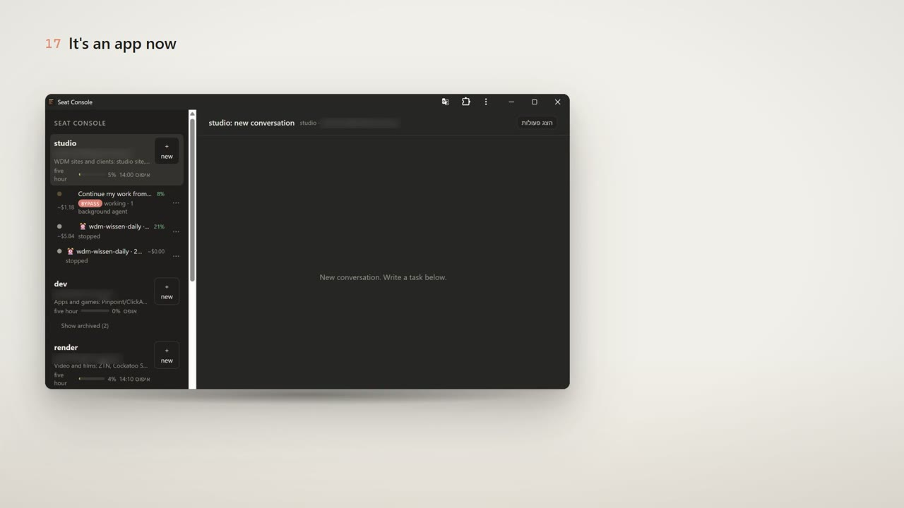

# Seat Console

Seat Console is a small local web console for running several Claude Code CLI sessions side by side, one per Claude account ("seat"), from one browser tab or your phone. If you work with more than one account, the usual setup is a pile of terminal windows: you lose track of which one is waiting for an approval, and a crash or a closed window takes the running session with it. Seat Console keeps every conversation in a detached background process, so restarting the console (or the console crashing) does not stop a running turn, and after a real PC crash it shows you what was cut off and resumes it when you tap.

It works with the Claude Code CLI that you installed and signed in to yourself. It does not modify the CLI or talk to any Claude API directly; it starts `claude -p` with stream-json input and output and shows the result.

> **Disclaimer.** Seat Console is an independent, unofficial tool. It launches the unmodified Claude Code CLI that you installed and signed in to yourself. It never reads, stores or transmits your Claude credentials. Each account must be one you are entitled to use; use one account per job and do not use it to get around usage limits. Not affiliated with or endorsed by Anthropic. Review Anthropic's Consumer Terms, Commercial Terms and Usage Policy before use. Use at your own risk.

## Demo video

[](docs/media/seat-console-demo.mp4)

A 3-minute walkthrough: one console for every agent, crash recovery, approvals and files on the phone.

## Features

- **Chat UI over several accounts.** The sidebar lists your seats, each with its conversations (title, status, cost). Every conversation is one long-lived `claude -p` process running under that seat's own `CLAUDE_CONFIG_DIR`, so it uses that seat's sign-in. Up to 5 live conversations per seat.
- **Permission modes per conversation:** `auto`, `ask` (approval cards in the chat: Allow once / Deny) and `bypass` (shown with a red badge).
- **Restart-proof.** Each conversation's `claude.exe` runs inside its own detached host process. Restarting or crashing the console server does not interrupt a turn; at start the server reattaches to every host and replays missed output and pending approvals.
- **Crash recovery.** A supervisor (scheduled task) restarts the server within seconds of any exit. After a PC crash, conversations that were mid-turn are marked `interrupted`. Nothing resumes by itself, because resuming spends quota: you resume them with `recover.ps1`, from the Telegram message, or with `/recover`.
- **Telegram bot (optional).** Finished / failed / waiting-for-approval notifications, Allow / Deny buttons, reply to a notification to continue that conversation (text, photo or file), start a new task from the phone, `/list`, `/status`, `/digest`, `/evening`, `/recover`, `/routines`. Images and PDFs a turn produces are sent along with the done message.
- **Routines.** Recurring prompts on a cron schedule. They never run unattended: at the due time you get a Telegram message with Run / Skip buttons, and the run starts on your tap (or with "Run now" in the web sidebar).
- **Daily digests** at 08:00 and 21:00: quota per seat, stuck conversations, what finished, errors in the server log, today's routines.
- **Phone-friendly, installable (PWA).** Works over Tailscale with Basic auth; with `tailscale serve` you get HTTPS and can install it as an app.
- **Handy extras.** Image attachments, per-seat 5-hour usage bar, context meter with Compact, archive / delete / rename, file previews of paths a reply mentions, "needs your answer" marks, pins and reply suggestions, gzip retention for old logs, `send.ps1` / `get.ps1` for scripting.
- **Zero npm dependencies.** Plain Node.js modules and static files. No build step.

## Requirements

Stated honestly, as tested:

- **Windows 11** is the tested platform (see [Platforms](#platforms) for Linux and macOS).
- **Node.js 24** (tested with 24.16). Older versions are untested.
- **Windows PowerShell 5.1** (built into Windows).
- **Python 3** on `PATH` as `python` (a tiny helper copies MCP and trust settings into each seat's config).
- **Claude Code CLI**, installed by you (native installer at `%USERPROFILE%\.local\bin\claude.exe`, or the npm global package) and **signed in by you**, once per seat. Seat Console never asks for or handles your credentials; the CLI keeps them in the seat's own config folder.
- Optional: **Tailscale** (phone access), a **Telegram** bot token (notifications and control).

## Platforms

- **Windows** is the tested platform and the one the console is used on every day.
- **Linux** support passes the offline tests and a fake-claude smoke test (`console/smoke-fake.mjs`) in WSL Ubuntu, but it has not been used in daily work.
- **macOS** code paths are written but have **not been tested on real Mac hardware**.
- **Remote servers** (the read-only view and full control over SSH, see [Remote servers](#remote-servers)) were tested only against a local WSL sshd with a fake claude, not yet against a real Claude login on a remote server.

Contributions and test reports for macOS and Linux are welcome: open an issue with your OS, Node version and what worked or broke.

## Install

```powershell
git clone https://github.com/beriki770-ship-it/seat-console.git
cd seat-console
copy seats.example.json seats.json
notepad seats.json
```

There is nothing to `npm install`.

## Configure

### `seats.json`

```json
{
  "projectsDir": "C:/Users/you/projects",
  "seats": {
    "dev": { "email": "dev-account@example.com", "role": "Application code: features, bug fixes, tests" },
    "ops": { "email": "ops-account@example.com", "role": "Operations: scripts, automation, infrastructure" }
  }
}
```

- `seats`: one entry per Claude account. The key is the seat name (used in the UI, in Telegram commands like `/dev`, and as the folder name). `email` is only a label so you know which account the seat should be signed in to. `role` is added to the seat's system prompt as its area of work.
- `projectsDir`: the default working folder for new conversations, and the root that file previews may read from. It must exist.

Each seat gets its own config folder at `%USERPROFILE%\.claude-seats\<seat>`. Its `agents`, `commands`, `hooks`, `plugins`, `projects` and `skills` folders are junctions to your main `%USERPROFILE%\.claude`, its `CLAUDE.md` imports the main one, and `settings.json` is copied in on every start. Only the sign-in stays per seat.

### Time zone

Digests and routine schedules use one wall clock, `Europe/Vienna` by default. Set yours once, then restart the console:

```powershell
setx SEAT_CONSOLE_TZ "America/New_York"
```

### Routines (optional)

```powershell
copy console\routines.example.json console\routines.json
```

Each entry: `id`, `prompt` (inline text) or `promptFile` (a Markdown file; YAML front matter is stripped), `cron` (5 fields), `seat`, `cwd`, `enabled`, `mode` (`auto`), and optional `model` / `effort`. The file is re-read when it changes, so no restart is needed.

## Sign in each seat

Run this once per seat in a normal PowerShell window. A browser opens: sign in with the account you want for that seat.

```powershell
powershell -ExecutionPolicy Bypass -File .\seat.ps1 dev -Login
powershell -ExecutionPolicy Bypass -File .\seat.ps1 -Status
```

Tip: the browser signs in with whatever Claude account it is already logged in to. Use a private window per seat and close all private windows before the next seat.

You can also open a seat as a normal interactive terminal session: `.\seat.ps1 dev`.

## Run

```powershell
powershell -ExecutionPolicy Bypass -File .\console\start-console.ps1
```

This starts the server and opens `http://127.0.0.1:4850`. It is idempotent: if the console is already running, it only opens the browser.

Start automatically at logon, with a supervisor that restarts the server after any exit (also creates Start Menu and Desktop shortcuts, including "Seat Console - Recover"):

```powershell
powershell -ExecutionPolicy Bypass -File .\console\install-autostart.ps1
```

Stop for good: `Stop-ScheduledTask 'Seat Console'`, then stop whatever still listens on port 4850.

After a crash: `powershell -ExecutionPolicy Bypass -File .\recover.ps1` lists interrupted conversations and resumes each one (`-DryRun` only lists).

### Attachments

The Attach button in the composer takes any file, up to 50 MB (the page holds it in memory). Images go to the model as images; any other file is stored under `console/uploads/<conversation>/` and the message tells the model its path. On a remote-control conversation the file is copied over ssh to the remote first. In Telegram, a document, video or audio sent as a reply to a notification goes into that conversation; Telegram's bot limit is 20 MB, so bigger files must go through the console. Uploads are removed with the conversation.

### Files the console writes

All of these are gitignored: `console\state.json`, `console\logs\` (one JSONL per conversation), `console\uploads\`, `console\token.txt` (CSRF token for every POST), `console\server.log`, `console\supervisor.log`. Two secret files live outside the repo, in `%USERPROFILE%\.claude\secrets\`:

- `seat-console-auth.json`: user name and a random password for remote (non-loopback) access. Created on first start.
- `seat-console-telegram.json`: your bot token and linked chat id (see below).

## Telegram setup

1. In Telegram, open @BotFather, send `/newbot` and copy the token.
2. Create `%USERPROFILE%\.claude\secrets\seat-console-telegram.json`:
   ```json
   { "botToken": "PASTE-THE-TOKEN-HERE", "chatId": "" }
   ```
   and replace the placeholder with your token. Never commit this file.
3. Start (or restart) the console. While `chatId` is empty, it writes a one-time code to `console\telegram-link-code.txt` and to the server log (`telegram: send /start <code> to link`).
4. Send `/start <code>` to your bot. Only that exact message links the chat, so a stranger who finds your bot cannot take it over. The console then saves the `chatId` and deletes the code file.

Send `/help` to the bot for the command list. Reply to any notification to continue that conversation. To move the bot to another chat, clear `chatId` and restart.

## Phone access via Tailscale

The console listens on `127.0.0.1:4850` and, when Tailscale is running, also on your PC's Tailscale IPv4 address. It never listens on `0.0.0.0`. Every request that does not come from the PC itself must pass Basic auth (user and password from `seat-console-auth.json`).

1. Install Tailscale on the PC and on the phone, signed in to the same tailnet.
2. On the phone, open `http://<pc-tailscale-ip>:4850` (find the IP with `tailscale ip -4`) and log in.

To install it as an app, the phone needs HTTPS, which `tailscale serve` provides inside your tailnet only (no Funnel, so it is not on the public internet):

1. In the Tailscale admin console, under DNS, enable MagicDNS and HTTPS certificates.
2. On the PC: `tailscale serve --bg --https=443 http://127.0.0.1:4850`
3. On the phone, open `https://<pc-name>.<your-tailnet>.ts.net`, log in once, then use the browser menu: Install app.

Undo with `tailscale serve reset`. Requests that come in through `tailscale serve` are treated as remote and need Basic auth, even though they reach the server from loopback.

## Linux / macOS

Same server and files; Windows behaviour is unchanged. Needs Node 22+, `claude` on `PATH` (or `~/.local/bin/claude`), `sh`, `ps` (macOS; Linux reads `/proc`), `lsof` or `fuser` (only for `start-console.sh`), and `python3` (only to merge `~/.claude.json` settings into each seat). Set `projectsDir` in `seats.json` to a folder that exists, for example `/home/you/projects`.

```sh
git clone https://github.com/beriki770-ship-it/seat-console.git ~/seat-console
cd ~/seat-console && cp seats.example.json seats.json   # then edit it
sh seat.sh dev --login          # once per seat; sh seat.sh --status lists them
sh console/start-console.sh     # starts the server, opens http://127.0.0.1:4850 (--no-browser to skip)
```

Seats live in `~/.claude-seats/<seat>`, with symlinks (instead of junctions) to your `~/.claude` folders. `sh console/run-server.sh` is the supervisor: it restarts the server after any exit (at most 6 starts a minute) and stops it on SIGTERM.

**Autostart on Linux (systemd user service).** `console/seat-console.service` assumes the repo at `~/seat-console`; edit the paths if it lives elsewhere.

```sh
mkdir -p ~/.config/systemd/user && cp console/seat-console.service ~/.config/systemd/user/
systemctl --user daemon-reload && systemctl --user enable --now seat-console
loginctl enable-linger "$USER"   # keep it running when you are logged out, and start it at boot
```

Keep `KillMode=process` in the unit: the default would kill every running conversation's host on a restart.

**Autostart on macOS (launchd, untested on real hardware).** In `console/seat-console.plist` replace `/Users/YOU/seat-console` with the repo path (launchd does not expand `~`), then:

```sh
cp console/seat-console.plist ~/Library/LaunchAgents/seat-console.plist
launchctl bootstrap gui/$(id -u) ~/Library/LaunchAgents/seat-console.plist
# stop and remove: launchctl bootout gui/$(id -u)/seat-console
```

Still Windows-only: `smoke.ps1` / `smoke.mjs`, `recover.ps1`, `send.ps1`, `get.ps1` and `install-autostart.ps1` (the service and plist files replace it).

## Remote servers

The console can also show Claude runs on other Linux machines, reached over SSH. Copy `remotes.example.json` to `remotes.json` in the repo root (gitignored) and restart the console. Each entry: `name` (`a-z`, `0-9`, `-`), `target` (`user@host`), `identity` (key file; `~` is your home folder), `seat` (a label), `paths` (globs of stream-json run files). The host key must already be in `known_hosts`: ssh runs in batch mode and never asks.

**Read-only (the default).** Runs of `claude -p --output-format stream-json` that write to a file on the remote show up as conversations under `remote: <name>`, live. The console only ever runs `ls` and `tail` there. It follows the newest 20 matching files per remote and mirrors their lines to `console/logs/remote-<name>/`. These rows have no composer, and every POST for them is refused. If the remote is unreachable, the group says so and the console retries with backoff; the console start never waits for a remote.

**Full control (`"control": true`).** The console can then start conversations that run on the remote, under the remote user's own Claude login: send, Stop, approvals, compact, rename, idle stop and resume work as for a local seat, and a finished run gets a "Continue this session" button. Optional fields: `port` (ssh port), `node` and `claude` (paths of the remote binaries; a non-interactive ssh has a short `PATH`, so the native installer's claude is usually `~/.local/bin/claude`). The remote needs Linux, Node 18+, a signed-in `claude`, `setsid`, `realpath`, `stat`, and sshd with `AllowTcpForwarding yes` (the default). Run the one-time setup, which only writes `~/.seat-console/` there (run it again after updating `host.mjs`, `hostlink.mjs` or `procid.mjs`):

```sh
node console/rhost.mjs setup <name>
```

The console reaches each remote host over `ssh -W` (stdio forwarding), so no port is opened on either side. Remote hosts keep running when the console restarts and are reconnected afterwards. Removing `"control"` from an entry parks its conversations (hidden and refused) until you set it again, so stop them first.

## Scripting

```powershell
.\console\send.ps1 -Seat ops -TextFile task.txt [-Model <model-id>] [-Mode auto|ask|bypass] [-Cwd <dir>] [-Conversation <id>] [-Wait]
.\console\get.ps1 -Conversation <id> [-Wait]
```

`send.ps1` prints `conversationId: <id>`; without `-Conversation` it starts a new conversation. Put the text in a UTF-8 file.

## Tests

Offline tests, no Claude account or quota needed:

```powershell
$env:TZ = 'Europe/Vienna'   # one routine test assumes the local clock is the default SEAT_CONSOLE_TZ
Get-ChildItem console\test-*.mjs | ForEach-Object { node $_.FullName; if ($LASTEXITCODE) { "FAILED: $($_.Name)" } }
```

`node console/smoke-fake.mjs --port 4852` runs a test instance with a fake claude (no login, no quota) and checks start, reply, a hard kill of the server mid-turn, reattach, Stop and leftovers; on Linux / macOS add `--supervisor` to cover `run-server.sh` too. It takes the seat name from your `seats.json`.

`console\smoke.ps1` is an end-to-end test on a separate test instance (port 4851). **It uses a real seat named `ops` and spends real quota** (small model), so run it only when you mean to. `console\start-test.ps1` / `stop-test.ps1` start and stop that isolated test instance (own data folder, no Tailscale, Telegram off).

## Security

See [SECURITY.md](SECURITY.md). In short: loopback plus Tailscale only, Basic auth for anything remote, a CSRF token on every POST, Host and Origin checks, and file previews limited to `projectsDir` and the conversation's folder, never secret-looking files. `bypass` mode lets the CLI run tools without asking: use it only where you would run the CLI that way yourself.

## License

Apache License 2.0, see [LICENSE](LICENSE).
